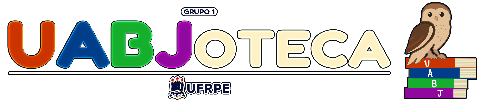

        

<br>
<br>

> [!NOTE]
> Projeto desenvolvido pelo **Grupo 1** para compor a **2ª VA** de **Programação 2 (2026.2)**.<br>
> Este Trabalho é vinculado ao Bacharelado em Engenharia da Computação da **Universidade Federal Rural de Pernambuco, Unidade Acadêmica de Belo Jardim (UFRPE/UABJ)**.

---

## 📋 Índice

- [Sobre o Projeto](#-sobre-o-projeto)
- [Funcionalidades](#-funcionalidades)
- [Regras de Negócio](#%EF%B8%8F-regras-de-negócio)
- [Conceitos da Programação Orientada a Objetos](#-conceitos-da-programação-orientada-a-objetos)
- [Instalação e Execução](#-instalação-e-execução)
- [Cronograma de Entregas](#-cronograma-de-entregas)

---

## 📖 Sobre o Projeto

O **UABJoteca** é um sistema de gerenciamento de biblioteca desenvolvido em Java com foco na aplicação prática dos pilares da **Programação Orientada a Objetos (POO)**.

O projeto tem como objetivo controlar a circulação de livros do acervo entre diferentes perfis de leitores (**Alunos** e **Professores**), automatizando prazos de devolução, limites de empréstimos simultâneos e cálculo de multas em caso de atraso, com regras de negócio protegidas por exceções customizadas.

Sua estrutura foi planejada de forma modular e orientada a camadas (`modelos`, `gerenciadores`, `excecoes` e `telas`), integrando regras de domínio bem encapsuladas, persistência de dados em **SQLite (JDBC/DAO)**, interface gráfica em **Java Swing** e exportação de relatórios em **CSV**.

---

## ✨ Funcionalidades

| | Funcionalidade | Descrição |
| :---: | :--- | :--- |
| <sub> </sub> | <sub> </sub> | <sub> </sub> |
| 📚 | **Consulta de Acervo** | Listagem dos livros cadastrados no sistema com título, autor, ISBN, exemplares disponíveis e total de exemplares, além de controle interno de entrada e baixa no estoque. |
| 👥 | **Perfis de Usuários** | Listagem de leitores diferenciados entre **Alunos** e **Professores**, exibindo matrícula, prazo de devolução, taxa diária de multa e empréstimos ativos em relação ao limite máximo. |
| 🔄 | **Registro de Empréstimos** | Realização de retiradas a partir do ID do usuário e do livro, validando disponibilidade e limite ativo, com cálculo automático da data prevista de devolução. |
| 💸 | **Devolução e Cálculo de Multas** | Encerramento de empréstimos com data atual ou data informada manualmente (`AAAA-MM-DD`), apurando automaticamente os dias de atraso e a multa correspondente ao perfil. |
| ⏰ | **Listagem e Filtros de Empréstimos** | Consulta detalhada dos empréstimos usando os filtros `TODOS`, `ATIVOS`, `ENCERRADOS` e `ATRASADOS`, exibindo status, dias de atraso e multa acumulada ou total. |
| 🛡️ | **Validação via Terminal** | Menu interativo no console com tratamento de entradas inválidas (campos vazios, números ou datas fora do padrão) e exibição de mensagens de erro sem interromper a execução. |
| <sub> </sub> | <sub> </sub> | <sub> </sub> |

---

## ⚖️ Regras de Negócio

O domínio do sistema aplica políticas distintas conforme a categoria do usuário:

| Perfil | Prazo de Devolução | Multa Diária por Atraso | Limite de Empréstimos Simultâneos |
| :--- | :---: | :---: | :---: |
| <sub> </sub> | <sub> </sub> | <sub> </sub> | <sub> </sub> |
| **Aluno** | 7 dias | R$ 1,00 / dia | 3 empréstimos |
| **Professor** | 15 dias | R$ 0,50 / dia | 5 empréstimos |
| <sub> </sub> | <sub> </sub> | <sub> </sub> | <sub> </sub> |

**Restrições adicionais garantidas por exceções customizadas:**
- `LivroIndisponivelException`: Impede o empréstimo de títulos sem exemplares disponíveis no acervo.
- `LimiteEmprestimosException`: Bloqueia novas retiradas caso o usuário já tenha atingido seu teto de empréstimos ativos.
- `EmprestimoEncerradoException`: Impede o encerramento ou devolução de um empréstimo que já foi concluído anteriormente.
- `OperacaoInvalidaException`: Impede a redução do total de exemplares de um livro em quantidade maior do que os exemplares disponíveis no momento.
- `RegistroNaoEncontradoException`: Sinaliza buscas ou operações sobre IDs inexistentes de usuário, livro ou empréstimo.

---

## 🧩 Conceitos da Programação Orientada a Objetos

| Conceito | Onde aparece | Aplicação no Projeto |
| :--- | :--- | :--- |
| <sub> </sub> | <sub> </sub> | <sub> </sub> |
| **Classe Abstrata** | `Usuario` | Define a estrutura base dos leitores e obriga as subclasses a implementarem prazo, taxa, limite e tipo. |
| **Herança e Liskov** | `Aluno` e `Professor` | Estendem `Usuario` sem duplicar código e podem substituí-lo em qualquer parte do sistema. |
| **Polimorfismo** | `Emprestimo` e `BibliotecaApp` | Chamam `getPrazo()` e `getTaxa()` via `Usuario` sem usar condicionais para descobrir o tipo. |
| **Encapsulamento** | `Livro`, `Usuario` e `Emprestimo` | Atributos privados alterados apenas por métodos controlados, como `emprestarExemplar()` e `devolver()`. |
| **Sobrecarga** | `Emprestimo` e `GerenciadorEmprestimos` | Múltiplas assinaturas em `devolver()`, `encerrarEmprestimo()` e `listarEmprestimos()`, além dos construtores. |
| **Relacionamentos** | `Emprestimo` e `GerenciadorEmprestimos` | Agregação com `Usuario` e `Livro`, composição da lista de empréstimos e dependência de `FiltroEmprestimos`. |
| <sub> </sub> | <sub> </sub> | <sub> </sub> |

---

## 🚀 Instalação e Execução

> [!IMPORTANT]
> Este projeto requer o **Java JDK 17** ou superior instalado na máquina.

### Opção 1: Clonando o Repositório

1. Clone o projeto e acesse a pasta.
2. Execute o arquivo **BibliotecaApp.java** localizado em `src/main/java/telas` em sua IDE de preferência ou através do terminal.

### Opção 2: Pelo Executável

1. Baixe o arquivo `biblioteca-ENTREGA-2.jar` [aqui](https://github.com/Projeto-POO-Grupo-1-UFRPE-UABJ/biblioteca-java/releases/tag/entrega2).
2. Abra o terminal na pasta onde o arquivo foi salvo e execute o seguinte comando:

   ```bash
   java -jar biblioteca-ENTREGA-2.jar
   ```
   
---

## 📆 Cronograma de Entregas

- [x] **Entrega 1 (`06/11`) - Modelagem:** Diagrama UML e protótipos de tela. [<kbd>🏷️ entrega1</kbd>](https://github.com/Projeto-POO-Grupo-1-UFRPE-UABJ/biblioteca-java/tree/entrega1)
- [X] **Entrega 2 (`19/11`) - Núcleo do Domínio:** Classes de modelo, regras de negócio aplicadas, exceções e main funcional no terminal. [<kbd>🏷️ entrega2</kbd>](https://github.com/Projeto-POO-Grupo-1-UFRPE-UABJ/biblioteca-java/tree/entrega2)
- [ ] **Entrega 3 (`27/11`) - Versão Final (Dados e GUI):** Integração com banco SQLite, classes DAO, interface gráfica em Swing e exportação CSV. <kbd>🏷️ entrega3</kbd>
